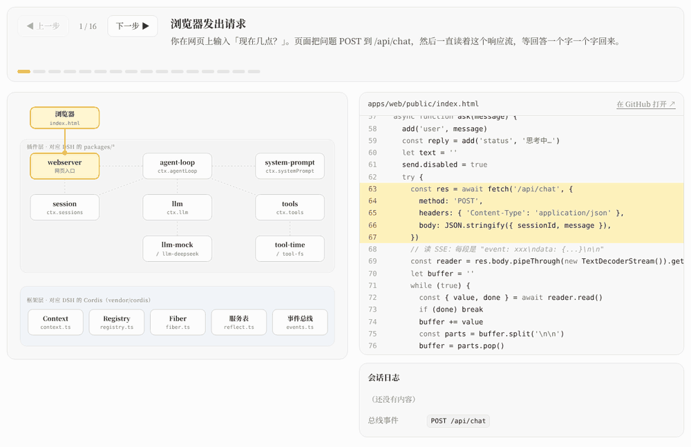

# 一切皆插件：DeepSeek Harness 最核心的设计

> DeepSeek Harness（DSH）有一百多万行代码，但它的骨架只有一个想法：一切皆插件。模型、工具、会话、提示词，连 Agent 循环本身，都是插在同一块「主板」上的插件。
>
> 这个系列用一个一千来行的迷你复刻版 NamiDSH，把这个想法从里到外拆开。这是第一篇，先看全貌。

## 01 先看一段 DSH 的真实代码

DSH 里负责 Agent 循环的是 `packages/core/agent-loop`。它的开头是这样的：

```ts
export class AgentLoop extends Service implements AgentFactory {
  static inject = ['agents', 'sessions', 'llm', 'tools', 'systemPrompt']
  static Config = z.object({ /* ... */ })

  constructor(ctx: Context, config: Config) {
    super(ctx, 'agentLoop')
    ctx.effect(() => ctx.agents.setFactory(this))
    // ...
  }
}
```

这几行没有出现任何具体的模型，也没有出现任何具体的工具。Agent 循环只声明了一件事：我需要 `llm`、`tools`、`sessions` 这几样东西，名字叫这个就行，谁提供的我不关心。

这就是「一切皆插件」：

- **每个功能都是一个插件**。Agent 循环是插件，DeepSeek 模型接入是插件，读文件的工具是插件，会话存储也是插件。
- **插件之间不互相 import**。它们只认服务名（`ctx.llm`、`ctx.tools`）和事件名（`tools/pre-execute`、`agent/text-delta`）。
- **插件挂在一个框架上**。这个框架叫 Cordis，它负责：谁先启动、谁在等谁、谁卸载时要清理什么。

DSH 仓库里一共有 519 个文件 import 了 Cordis。可以说，读懂 Cordis，就读懂了 DSH 的骨架。

## 02 这样设计换来了什么

只看概念有点虚。把它换成三个具体的问题，就能看出这种设计的价值。

**换一家模型，要改多少代码？** 一行都不改。模型接入是一个插件，它把自己登记为 `llm` 服务的一个适配器。拔掉 DeepSeek 插件，插上另一家，Agent 循环完全不知道发生了什么。

**想在工具执行前加一道审批，要改哪里？** 不改工具，也不改循环。工具执行要经过一个叫 `tools/pre-execute` 的事件，挂一个监听，想拦就拦。DSH 里的权限、沙箱、超时，都是这么挂上去的。

**一个插件卸载了，它注册的东西会不会留下垃圾？** 不会。插件做的每一件注册（提供服务、监听事件、登记工具、开定时器）都会记在它自己名下，卸载时由框架统一撤销。

这三点，后面每一篇都会用真实代码和真实运行结果来验证。

## 03 为什么要做一个迷你版

DSH 的 Cordis 本身就有 2693 行，里面有大量工程细节：调用栈追踪、作用域隔离、可调用服务、类型体操。第一次读源码，很容易陷在这些细节里，看不清主线。

所以我做了 [NamiDSH](https://github.com/aa1143/NamiDSH)，一个按原样缩小的复刻版：

- **迷你版 Cordis**：约 680 行 TypeScript。文件结构和真 Cordis 一一对应（`fiber.ts`、`reflect.ts`、`events.ts`、`registry.ts`……），API 名字也一样。
- **迷你版 DSH**：11 个包，名字对应 DSH 的同名包：`llm`、`tools`、`session`、`system-prompt`、`agent-loop`……写法同样是 `class Xxx extends Service` 加 `static inject`。
- **网页端 Agent**：`npm start` 打开浏览器就能对话，可以接 DeepSeek，没有 API Key 也能离线跑。

迷你，但不是玩具。我写了 14 个测试场景，同一份测试分别跑在迷你版和 DSH 仓库里的真 Cordis 上，两边输出逐行一致，包括每个插件状态变化的先后顺序。第 7 篇会专门讲这件事。

## 04 一张图看全貌

整个项目可以画成两层：

- **上层是插件**：webserver、agent-loop、llm、tools、session、system-prompt，还有模型适配器和工具插件。它们对应 DSH 的 `packages/*`。
- **下层是框架**：Context、Registry、Fiber、服务表、事件总线。它们对应 DSH 的 `vendor/cordis`。

我把这张图做成了[可以交互的页面](https://namiai.tech/dsh/)。点任意一块，右边显示它的真实代码；按「下一步」，可以看到一次提问「现在几点？」怎么从浏览器进来，经过哪些插件，又怎么一个字一个字流回浏览器。



建议先把这张图从头到尾点一遍，再回来读后面的文章。图里每一块，后面都有一篇对应的文章展开讲。

## 05 这个系列怎么读

| 篇 | 讲什么 | 对应 |
|---|---|---|
| 01 | 一切皆插件（本篇） | 全貌 |
| 02 | 插件与 Context：插件拿到的到底是什么 | `context.ts`、`registry.ts` |
| 03 | Fiber：一个插件的一生 | `fiber.ts` |
| 04 | 服务与依赖注入：`ctx.llm` 是怎么来的 | `reflect.ts`、`service.ts` |
| 05 | 事件总线：插件之间怎么说话 | `events.ts` |
| 06 | 用插件搭一个 Agent：一次提问的完整旅程 | `packages/*` |
| 07 | 和真 Cordis 逐行对照：迷你版省了什么 | 兼容性测试 |

02 到 05 讲框架，06 讲怎么用这个框架搭出一个 Agent，07 回到真实的 DSH 源码。

所有代码都可以自己跑：

```bash
git clone https://github.com/aa1143/NamiDSH
cd NamiDSH
npm install   # 只是把 packages/* 链接起来，没有运行时依赖
npm start     # 打开 http://localhost:3000
npm test      # 兼容性测试 + Agent 测试
```

需要 Node.js 22.18 以上，它可以直接运行 TypeScript，不用编译。

下一篇从最底层开始：一个插件被挂上去的那一刻，框架到底给了它什么。
